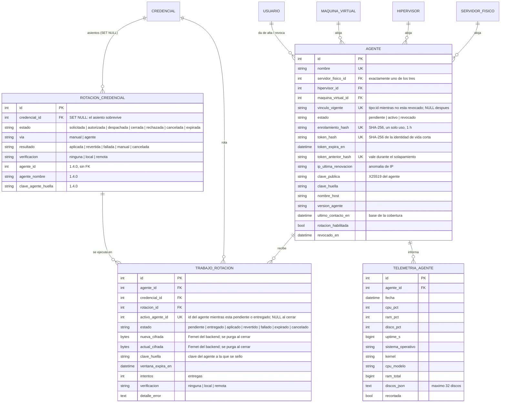

# Modelo de datos relacional

## Jerarquía del inventario

La segmentación se modela con **tres activos de nivel superior** (servidor físico dedicado,
hipervisor y dispositivo de red) enlazados por claves foráneas. El hipervisor es la propia
máquina física (con su hardware) y aloja directamente sus máquinas virtuales; el dispositivo
de red cubre la electrónica de red (switch, router, firewall, punto de acceso, balanceador…):

```mermaid
erDiagram
    HIPERVISOR ||--o{ MAQUINA_VIRTUAL : "ejecuta"
    SERVIDOR_FISICO ||--o{ CREDENCIAL : "tiene"
    HIPERVISOR ||--o{ CREDENCIAL : "tiene"
    MAQUINA_VIRTUAL ||--o{ CREDENCIAL : "tiene"
    DISPOSITIVO_RED ||--o{ CREDENCIAL : "tiene"
    USUARIO ||--o{ SESION_WEB : "abre"
    USUARIO ||--o{ CREDENCIAL : "registró"
    USUARIO ||--o{ REGISTRO_AUDITORIA : "genera"
    USUARIO ||--o{ CODIGO_RECUPERACION_MFA : "posee"
    USUARIO ||--o{ CONCESION_ACCESO : "recibe (analista)"
    USUARIO ||--o{ ENTRADA_VAULT : "posee (vault personal)"
    SERVIDOR_FISICO ||--o{ CONCESION_ACCESO : "concedido"
    HIPERVISOR ||--o{ CONCESION_ACCESO : "concedido"
    MAQUINA_VIRTUAL ||--o{ CONCESION_ACCESO : "concedido"
    DISPOSITIVO_RED ||--o{ CONCESION_ACCESO : "concedido"

    SERVIDOR_FISICO {
        int id PK
        string nombre UK
        text descripcion "sistema o funcion que cumple"
        string sistema_operativo
        string marca_modelo
        string ubicacion
        string ip_gestion
        string ram_cpu_almacenamiento "hardware"
        bool restringido "solo administradores"
    }
    HIPERVISOR {
        int id PK
        string nombre UK
        string plataforma "Proxmox, ESXi, Hyper-V..."
        string version
        string ip_gestion
        text descripcion
        string ram_cpu_almacenamiento "hardware propio"
        bool restringido "solo admins (las VMs lo heredan)"
    }
    MAQUINA_VIRTUAL {
        int id PK
        int hipervisor_id FK
        string nombre
        string sistema_operativo
        string ip
        text descripcion "sistema que corre"
        string ram "RAM asignada"
        string cpu "vCPU/nucleos asignados"
        string almacenamiento "disco asignado"
    }
    DISPOSITIVO_RED {
        int id PK
        string nombre UK
        string tipo_dispositivo "switch | router | firewall | access_point | balanceador | otro"
        string marca_modelo
        string version "firmware"
        string ip_gestion
        string ubicacion
        string puertos "p. ej. 48x 1GbE + 4x SFP+"
        bool restringido "solo administradores"
        text descripcion
    }
    CREDENCIAL {
        int id PK
        int servidor_fisico_id FK "exactamente uno de los cuatro"
        int hipervisor_id FK
        int maquina_virtual_id FK
        int dispositivo_red_id FK
        string usuario_acceso
        bytes password_cifrada "Fernet AES"
        string servicio "SSH, RDP, iLO..."
        int puerto
        text descripcion
        int creado_por_id FK
        datetime password_rotada_en "alertas de rotacion"
        string via_rotacion "manual | agente (1.4.0) | conector (2.3.0)"
    }
    CODIGO_RECUPERACION_MFA {
        int id PK
        int usuario_id FK
        string codigo_hash UK "SHA-256, un solo uso"
        datetime usado_en
    }
    ENTRADA_VAULT {
        int id PK
        int usuario_id FK "dueño (privado)"
        string titulo
        string usuario_acceso
        bytes password_cifrada "Fernet AES"
        string url
        string categoria "servicio | aplicacion | cuenta | otro"
        text notas
        datetime password_rotada_en
    }
    USUARIO {
        int id PK
        string username UK
        string email UK
        string password_hash "Argon2id"
        string rol "admin | operador | auditor | analista"
        bytes totp_secret_cifrado
        bool mfa_habilitado
        bool activo
    }
    CONCESION_ACCESO {
        int id PK
        int usuario_id FK "analista"
        int servidor_fisico_id FK "exactamente uno de los cuatro"
        int hipervisor_id FK
        int maquina_virtual_id FK
        int dispositivo_red_id FK
        string nivel "ver | ver_credenciales"
        int concedido_por_id FK "admin"
        datetime expira_en "caducidad opcional"
    }
    SESION_WEB {
        int id PK
        string token_hash UK "SHA-256"
        int usuario_id FK
        string etapa "cambio_password | mfa_enrolamiento | mfa_pendiente | activa"
        datetime expira_en
        datetime revocada_en
    }
    REGISTRO_AUDITORIA {
        int id PK
        datetime fecha
        int usuario_id FK
        string accion
        string objeto_tipo
        string objeto_id
        text detalle
        string direccion_ip
        bool exito
    }
```

## Reglas de integridad

1. **Activos de nivel superior**: el servidor físico dedicado, el hipervisor y el
   dispositivo de red son entidades independientes; el hipervisor es la propia máquina
   física (con su hardware) y no se anida bajo un servidor físico. El dispositivo de red
   lleva su clase en `tipo_dispositivo` (CHECK: `switch | router | firewall | access_point
   | balanceador | otro`).
2. **Máquinas virtuales**: siempre pertenecen a un hipervisor (`hipervisor_id NOT NULL`).
3. **Credenciales**: restricción CHECK que exige exactamente **una** de las cuatro claves
   foráneas (`servidor_fisico_id`, `hipervisor_id`, `maquina_virtual_id`,
   `dispositivo_red_id`); imposible una credencial huérfana o ambigua.
4. **Borrado en cascada**: eliminar un servidor físico elimina sus hipervisores, las VMs
   de estos y todas las credenciales asociadas; eliminar un hipervisor hace lo propio con
   sus VMs y credenciales; eliminar un dispositivo de red elimina sus credenciales.
5. **Secretos**: `password_cifrada` y `totp_secret_cifrado` nunca contienen texto plano;
   `token_hash` impide reutilizar un volcado de BD para secuestrar sesiones.
6. **Auditoría**: `usuario_id` usa `ON DELETE SET NULL` y se conserva el `username`
   textual, de modo que la trazabilidad sobrevive a cualquier baja.
7. **Concesiones de acceso**: misma restricción CHECK de «exactamente un activo» que las
   credenciales (los cuatro tipos, dispositivos de red incluidos), más `UNIQUE(usuario,
   activo)` (sin duplicados) y `nivel ∈ {ver, ver_credenciales}`. `ON DELETE CASCADE`
   desde el usuario y desde el activo: al eliminar cualquiera, sus concesiones
   desaparecen. No hay herencia entre niveles del inventario.
   Detalle del modelo de acceso en [`control-acceso.md`](control-acceso.md).
8. **Restricción a administradores** (`restringido`): bandera booleana en servidor físico,
   hipervisor y dispositivo de red (las VMs la heredan de su hipervisor, por eso no llevan
   columna propia). Un activo restringido es invisible para los operadores (404) y visible
   para los auditores sin poder revelar contraseñas; el analista solo lo ve con concesión
   explícita, que prevalece sobre la restricción. Solo el administrador la cambia
   (`inventario.restringir`). Ver [`control-acceso.md`](control-acceso.md).
8. **Vault personal** (`ENTRADA_VAULT`): pertenece a **un** usuario (`usuario_id`,
   `ON DELETE CASCADE`) y es **privado** —solo el dueño la ve, edita y revela; ni el
   administrador accede a su contenido—. `password_cifrada` (Fernet) nunca en claro;
   `categoria ∈ {servicio, aplicacion, cuenta, otro}`. Es independiente del inventario:
   sirve para contraseñas de servicios, aplicaciones o cuentas propias. Se incluye en el
   respaldo cifrado, pero **nunca** en el export en claro de migración.

## Gobernanza de rotación y agentes (1.3.0 y 1.4.0)

La **1.3.0** añadió el libro mayor de rotaciones (`rotaciones_credencial`, migración `0010`) y la
columna `credenciales.via_rotacion`. La **1.4.0** añade, con la migración **`0011`**
(`migrations/versions/0011_agentes_y_trabajos.py`), tres tablas y tres columnas del libro mayor.
Todos los cambios son **aditivos**: una base de la 1.3.0 se pone al día al arrancar
(`schema_sync`) o con `alembic upgrade head`, sin perder el libro mayor. La `0011` es reversible,
pero su `downgrade` borra los agentes, los trabajos y la telemetría.

### Columnas nuevas en tablas existentes (1.4.0)

| Tabla | Columna | Tipo | Para qué |
|---|---|---|---|
| `rotaciones_credencial` | `agente_id` | entero, nulo, **sin clave foránea** | Qué agente ejecutó la rotación. Sin FK a propósito: la reconciliación de esquema añade columnas con `ADD COLUMN` y no crea FKs, y el libro mayor nunca se purga aunque el agente desaparezca con su activo. |
| `rotaciones_credencial` | `agente_nombre` | texto (120), `''` | Copia desnormalizada que mantiene legible el asiento, como `activo_nombre`. |
| `rotaciones_credencial` | `clave_agente_huella` | texto (64), `''` | Huella de la clave X25519 a la que se cifró el trabajo. |

`credenciales.via_rotacion` (de la 1.3.0) toma en esta versión el valor `agente` por primera vez.
Sigue **sin CHECK** a propósito (añadirlo a una tabla existente no sería aditivo): la validación
vive en el servicio.

### Reglas de integridad de los agentes

1. **Un agente, un activo**: CHECK `ck_agentes_un_activo` exige exactamente **una** de las tres
   claves foráneas (servidor físico, hipervisor o VM). Los **dispositivos de red no admiten
   agente**: se cubrirán con conectores (2.3.0).
2. **Un solo agente vigente por activo, con UNIQUE anulable.** `vinculo_vigente` vale
   `"tipo:id"` (p. ej. `fisico:12`) mientras el agente no está revocado y `NULL` después. Ni
   SQLite ni MySQL cuentan los `NULL` como repetidos en un `UNIQUE`, y MySQL no admite índices
   parciales: es la forma portable de que los revocados se conserven como historia sin impedir
   dar de alta el siguiente agente del mismo activo.
3. **Un solo trabajo activo por agente**, con el mismo mecanismo: `trabajos_rotacion.activo_agente_id`
   (UNIQUE) vale el id del agente mientras el trabajo está `pendiente` o `entregado`, y `NULL` al
   cerrarse. Dos despachos simultáneos al mismo agente chocan en la base de datos.
4. **Estado guardado frente a estado derivado.** `agentes.estado` solo guarda lo que decide una
   persona o el enrolamiento (`pendiente`, `activo`, `revocado`). «Conectado», «Sin contacto» e
   «Identidad caducada» se **calculan** al consultar a partir de `ultimo_contacto_en` y
   `token_expira_en`, de modo que una insignia no puede mentir porque un proceso de fondo dejara
   de correr.
5. **Secretos**: de cada token (enrolamiento, identidad vigente y anterior) solo se guarda el
   **hash SHA-256**. Las contraseñas del trabajo se guardan con el **Fernet del backend**, como
   cualquier credencial, y se **purgan** (`NULL`) al cerrar el trabajo; el sellado X25519 a la
   clave del agente se hace solo en la entrega. Un trabajo que queda «sin confirmar» **conserva**
   sus secretos hasta que una persona lo resuelve: la nueva puede ser la que vale en el activo.
6. **Borrado en cascada**: eliminar el activo elimina su agente, sus trabajos y su telemetría
   (`ON DELETE CASCADE`). Eliminar la credencial elimina sus trabajos. El **libro mayor no se
   borra**: `rotaciones_credencial.credencial_id` pasa a `NULL` y `agente_id` no tiene FK.
7. **Respaldo**: los agentes se respaldan **solo como historia** (sin tokens, enrolamiento ni
   clave pública) y se restauran **revocados**; los trabajos y la telemetría **no se respaldan
   nunca**. Ver [`manual-operativo.md`](manual-operativo.md) §21.4.
8. **Telemetría acotada**: solo agregados del propio host (sin procesos, usuarios ni rutas más allá
   del punto de montaje); como máximo 32 discos; lo que excede se recorta y se marca en
   `recortada`. Se purga pasados `AGENTES_RETENCION_TELEMETRIA_DIAS`.

Detalle del ciclo y del protocolo en [`arquitectura-agentes.md`](arquitectura-agentes.md).
